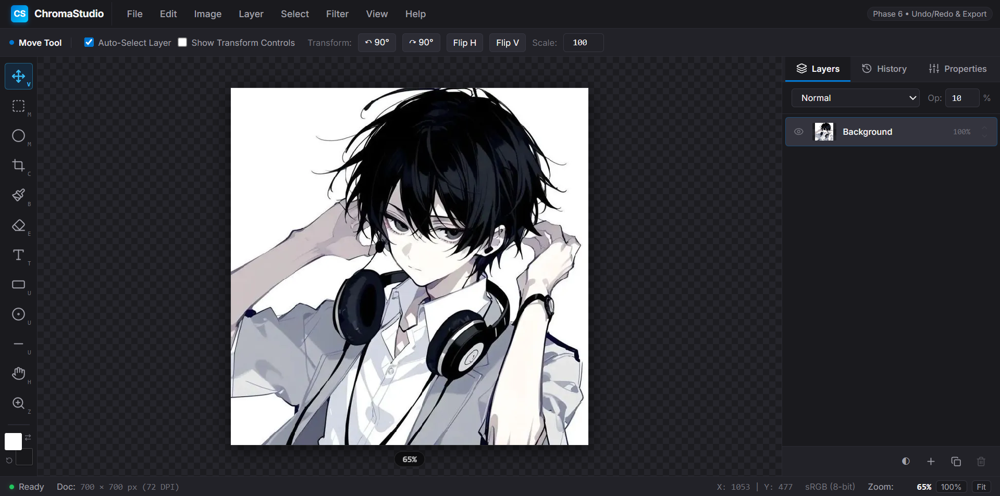
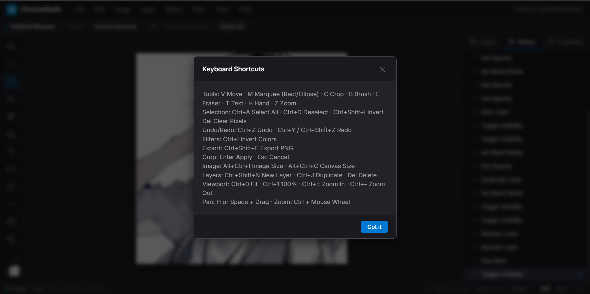

# ChromaStudio V1

ChromaStudio is a browser-based image editor built with React and Vite. It supports layered raster editing, editable text and shapes, selections, non-destructive adjustment layers, history, and export.

## Features

- PNG, JPEG, and WebP image loading and native-resolution PNG/JPEG/WebP export.
- Ordered layers with visibility, opacity, blend modes, rename, duplicate, delete, and reorder actions.
- Brush and eraser tools with opacity, selection clipping, and undo/redo.
- Rectangular and elliptical selections, inversion, clear selected pixels, and selected-pixel movement.
- Crop, image resize, canvas resize, and raster filters.
- Editable text layers and rectangle, ellipse, and line shape layers.
- Layer transforms: move, rotate, flip, and uniform scale.
- Non-destructive brightness, contrast, saturation, and grayscale adjustment layers affecting the stack beneath them.
- Unsaved-change confirmation when opening another image, closing a document, or leaving the page.

## Requirements

- Node.js 18 or newer.
- npm.

## Setup and development

```bash
npm install
npm run dev
```

Build a production bundle with:

```bash
npm run build
```

Preview the production bundle with:

```bash
npm run preview
```

## Tests

Run the focused regression suites from the project root:

```bash
node src/tests/test_reliability_guards.mjs
node src/tests/test_transforms_adjustments.mjs
node src/tests/test_vector_layers.mjs
node src/tests/test_selection.mjs
node src/tests/test_brush_eraser.mjs
npm run build
```

## Keyboard shortcuts

| Action | Shortcut |
| --- | --- |
| Undo / redo | Ctrl/Cmd+Z; Ctrl/Cmd+Y or Ctrl/Cmd+Shift+Z |
| Open image | Ctrl/Cmd+O |
| Export PNG | Ctrl/Cmd+Shift+E |
| Select all / deselect / invert selection | Ctrl/Cmd+A / Ctrl/Cmd+D / Ctrl/Cmd+Shift+I |
| New / duplicate layer | Ctrl/Cmd+Shift+N / Ctrl/Cmd+J |
| Image size / canvas size | Ctrl/Cmd+Alt+I / Ctrl/Cmd+Alt+C |
| Fit / 100% / zoom | Ctrl/Cmd+0 / Ctrl/Cmd+1 / Ctrl/Cmd+Plus or Minus |
| Tools | V Move, M Marquee, C Crop, B Brush, E Eraser, T Text, U Shapes, H Hand, Z Zoom |

## Known limitations

- Layer transform controls use document-center rotation and uniform numeric scaling; canvas bounding-box handles are not implemented.
- Adjustment layers use Canvas pixel processing on the main thread and are intended for ordinary image sizes.
- There is no project-file save format, layer masks, or clipboard integration.
- The app is client-side only and does not require API credentials.

## Screenshots

### Main editor and Layers



The editor canvas, transform controls, and mixed layer stack in use.

### Keyboard shortcuts



The in-app shortcut reference for tools, selections, history, export, and viewport controls.

## GitHub Pages

After the Pages workflow has deployed successfully, the application is expected at [https://kushwahaarnav15.github.io/ChromaStudio/](https://kushwahaarnav15.github.io/ChromaStudio/).

## GitHub publication

Commit source, tests, `package.json`, `package-lock.json`, `README.md`, `.gitignore`, `index.html`, and `vite.config.js`. Do not commit `node_modules`, `dist`, local `.env` files, `.backup-*` folders, or editor/OS cache files.
